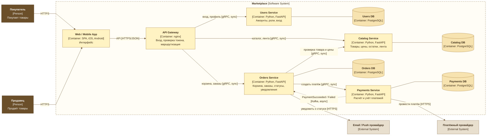

# Архитектура маркетплейса: C4 + сервис в Docker

Архитектура маркетплейса: C4 Container диаграмма, домены и границы данных, варианты декомпозиции с обоснованием

## 1. Запуск проекта

Требования: Docker с плагином Compose v2

```bash
docker compose up --build -d
curl -i http://localhost:443/health
docker compose down
```

Ожидаемый ответ:

```http
HTTP/1.1 200 OK
content-type: application/json

{"status":"ok","service":"catalog-service"}
```

## 2. C4 Container диаграмма

Сплошные стрелки - синхронные вызовы, пунктирная - событие через Kafka



## 3. Домены и их ответственность

Четыре домена, между ними распределены все шесть функций из задания:

| Домен | За что отвечает |
|---|---|
| **Users** - кто покупает и продаёт | Регистрация и вход, роли покупателя и продавца, профили, выдача токена входа |
| **Catalog** - что продаём | Товары, категории, цены, остатки. Карточки товаров для продавца. Проверка «можно ли купить товар по этой цене». Персонализированная лента |
| **Orders** - как покупают | Корзина, оформление заказа с фиксацией цены на момент покупки, статусы заказа. Уведомление покупателя при смене статуса |
| **Payments** - деньги | Расчёт суммы к оплате, проведение платежа через провайдера, учёт транзакций и возвратов |

Два решения внутри доменов:

- **Лента - часть Catalog.** Персонализация без ML: Catalog запоминает, какие карточки открывал покупатель, и показывает популярные товары из этих категорий. Новому покупателю - общий топ. Лента работает с теми же данными о товарах, своих данных у неё нет
- **Уведомления - часть Orders.** Уведомление - это реакция на смену статуса заказа, а статусами владеет Orders. Письмо или пуш отправляется фоновой задачей, чтобы медленный провайдер не задерживал ответ покупателю

## 4. Распределение доменов по сервисам

Один домен - один сервис. Кроме них на схеме два инфраструктурных контейнера: API Gateway (единая точка входа, проверка токена входа, передача `user_id` сервисам в заголовке) и Web / Mobile App (интерфейс без бизнес-логики)

| Сервис | Домен | Почему отдельный |
|---|---|---|
| Users Service | Users | Нужен всем остальным, меняется редко, хранит учётные данные, доступ к которым надо ограничить |
| Catalog Service | Catalog | Самая высокая нагрузка на чтение: каталог и ленту смотрят все покупатели, масштабируется независимо от заказов |
| Orders Service | Orders | Ядро покупки, нужна строгая консистентность внутри заказа |
| Payments Service | Payments | Данные карт: отдельный контур, чтобы строгие требования безопасности к карточным данным касались одного сервиса, а не всех |

**Логика разбиения.** Сервис выделяется там, где у данных свой владелец и свои требования - по нагрузке (Catalog - чтение, Orders и Payments - запись) или по безопасности (Payments). Лента и уведомления своих данных не имеют, поэтому остались внутри Catalog и Orders. Этот компромисс разобран в разделе 7

## 5. Границы владения данными и взаимодействия

У каждого сервиса своя база PostgreSQL, у Payments - в отдельном защищённом контуре. В чужую базу никто не ходит: данные другого сервиса получают только через его API или через событие

| Сервис | Владеет данными | За что отвечает |
|---|---|---|
| Users Service | Аккаунты, профили, роли, учётные данные | Вход и пользователи |
| Catalog Service | Товары, категории, цены, остатки, события просмотров | Каталог и лента |
| Orders Service | Корзины, заказы с зафиксированной ценой, статусы, журнал уведомлений | Заказы и уведомления |
| Payments Service | Платежи, транзакции, связь платёж-заказ | Платежи |

Взаимодействия сервисов:

| Кто | Кому | Как | Зачем |
|---|---|---|---|
| API Gateway | Users, Catalog, Orders | sync, gRPC | Запросы пользователей |
| Orders | Catalog | sync, gRPC | Проверить товар, цену и остаток при оформлении |
| Orders | Payments | sync, gRPC | Создать платёж на сумму заказа |
| Payments | Orders | async, событие через Kafka | Сообщить, что платёж прошёл или не прошёл |

Синхронно - когда без ответа нельзя продолжить: проверить цену, создать платёж. Асинхронно - когда это сообщение о свершившемся факте: Payments кладёт событие в очередь Kafka, Orders забирает его, когда готов. Если Orders в этот момент недоступен, событие дождётся в очереди

## 6. Альтернативные варианты декомпозиции

### Вариант 1

Одно приложение, один деплой. Внутри четыре модуля с теми же границами, одна общая база, модули вызывают друг друга напрямую, без сети

### Вариант 2

Шесть сервисов, по одному на каждую функцию из задания: Users, Catalog, Feed (лента), Orders, Payments, Notifications. У каждого своя база, лента хранит копию карточек товаров, уведомления ловят события заказов, все связаны через Kafka

### Вариант 3 (финальный)

Четыре сервиса по доменам: Users, Catalog с лентой, Orders с уведомлениями, Payments. Описан в разделах 2-5

| | Вариант 1 | Вариант 2 | Вариант 3 |
|---|---|---|---|
| Единиц развёртывания | 1 | 6 | 4 |
| Баз данных | 1 общая | 6 | 4 |
| Вызовов и событий между частями | 0 | около 11 | 4 |

## 7. Трейдофы вариантов

### Вариант 1

Плюсы:
- Проще всего разрабатывать и выкатывать: одно приложение, одна база
- Заказ и платёж в одной транзакции: либо всё прошло, либо ничего, без ручных откатов
- Нет сетевых ошибок между частями, дёшево в инфраструктуре

Минусы:
- Масштабируется и падает только целиком: каталог читают тысячи, а растить и чинить приходится всё приложение
- Данные карт рядом с остальными: строгие требования безопасности распространяются на всё приложение
- Общая база: со временем модули лезут в чужие таблицы, границы стираются

### Вариант 2

Плюсы:
- Каждая функция выкатывается и масштабируется отдельно
- Падение ленты или уведомлений не мешает покупке
- Удобно, когда у каждой функции своя команда

Минусы:
- Вдвое больше сетевых вызовов (11 против 4), каждый может упасть или зависнуть
- Лента хранит копию каталога, уведомления ходят за контактами, шесть событий: данные дублируются, а что случилось с заказом - сложно отследить
- Дорого: шесть сервисов, шесть баз, очередь, мониторинг на всё это

### Вариант 3

Плюсы:
- Отдельно масштабируется то, что реально нужно: каталог на чтение, заказы и платежи на запись
- У каждого сервиса своя база, платежи в отдельном защищённом контуре
- Четыре вызова и одно событие: систему можно объяснить за минуту

Минусы:
- Лента выкатывается вместе с каталогом: поменять алгоритм ленты - значит выкатить весь Catalog
- Уведомления внутри Orders: сбой email-провайдера надо гасить фоновой задачей
- Сеть между Orders, Catalog и Payments всё равно есть: нужны таймауты и отмена заказа, если платёж не прошёл

## 8. Финальный выбор и обоснование

**Выбран вариант 3 - четыре сервиса**

- **Почему не вариант 1.** У частей системы разные потребности: каталог читают все покупатели, заказы и платежи постоянно пишут, платежи нужно держать под замком. В одном приложении всё это растёт и падает вместе, а общая база со временем превращается в кашу, где каждый модуль лезет в чужие таблицы
- **Почему не вариант 2.** Лента и уведомления не хранят ничего своего: лента работает с товарами, уведомления - с заказами. Отдельные сервисы под них - это лишние сетевые вызовы, копии данных и ещё две базы ради независимости, которая пока никому не нужна
- **Почему именно четыре.** Это минимум, при котором разведены реальные различия: платежи под защитой, каталог масштабируется под чтение, заказы остаются целостными, вход у всех общий. Сетевых вызовов четыре, событие одно, систему можно объяснить за минуту

Если лента вырастет до ML или уведомлений станет много, их можно вынести из Catalog и Orders в отдельные сервисы: внутри они уже отдельные модули, так что это вынос, а не переписывание
