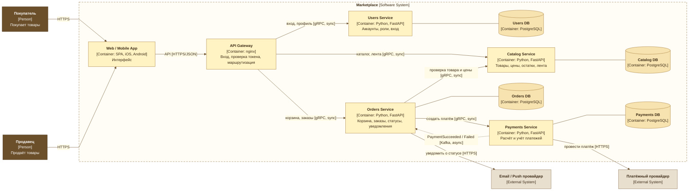

# C4 — Container diagram

Уровень C4 Container: маркетплейс как система, его контейнеры (сервисы и их хранилища), внешние системы и пользователи. Нотация C4: у каждого элемента указан тип (`[Person]`, `[Container: технология]`, `[External System]`), у каждой связи — назначение и протокол. Сплошные стрелки — синхронные вызовы, пунктирная — асинхронное событие через Kafka (технология указана на стрелке).

Детали владения данными, распределения доменов и обоснование решений — в [README](../README.md).

Если диаграмма не отрендерилась — [PNG-версия](c4-container.png).

## Легенда

| Элемент | Что означает |
|---|---|
| Тёмно-коричневый блок, `[Person]` | Пользователь системы |
| Пунктирная рамка, `[Software System]` | Граница маркетплейса |
| Жёлтый блок, `[Container: …]` | Отдельно развёртываемая единица: сервис или приложение |
| Жёлтый цилиндр, `[Container: PostgreSQL]` | База данных, принадлежащая ровно одному сервису |
| Бежевый блок, `[External System]` | Внешняя система, которой мы не владеем |
| `→` сплошная, `[gRPC, sync]` | Синхронный запрос-ответ |
| `⇢` пунктирная, `[Kafka, async]` | Событие через Kafka |
